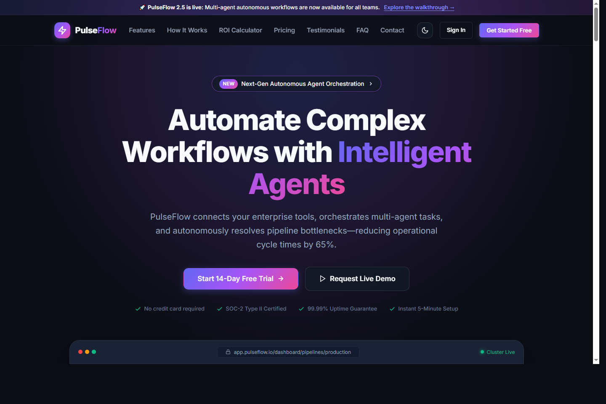
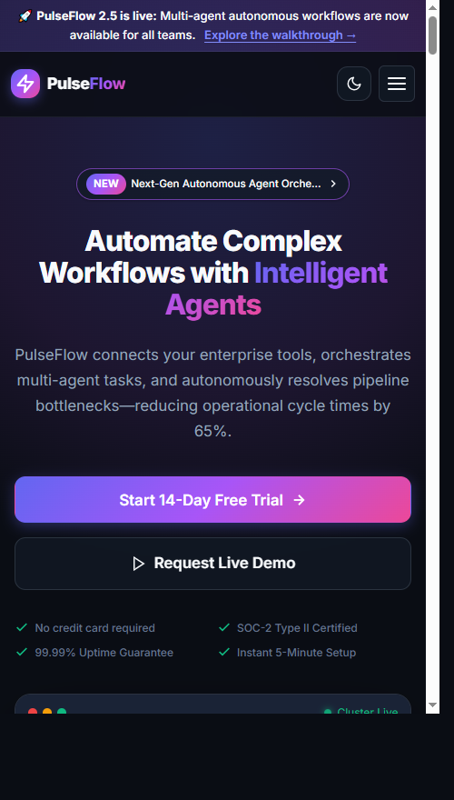

# ⚡ PulseFlow AI — Autonomous Workflow Intelligence Platform

> **Front-End Development Internship Assignment Submission**  
> **Company:** SANKAR GROUP | *Built to Make History*  
> **Candidate Submission:** Production-Ready, Fully Responsive SaaS Landing Page  

---

## 📌 1. Design Choices & Challenges Solved (Executive Summary)

```markdown
Design Choices & Challenges Solved:
1. Product Concept & Theme: Engineered "PulseFlow AI", an autonomous workflow automation platform, using a modern dark-first glassmorphic design system with a seamless Light/Dark mode toggle to communicate high reliability, technical sophistication, and enterprise-grade polish.
2. Visual Hierarchy & Spacing: Adopted a fluid typographic scale with Inter and system font stacks, paired with an 8pt spacing grid and CSS custom property tokens to maintain visual harmony across every section.
3. High-Impact Interactivity: Implemented zero-dependency, pure vanilla ES6+ interactions including an interactive ROI calculator, dynamic monthly/annual pricing recalculation, tabbed product walkthroughs, an interactive pipeline simulator, and an accessible FAQ accordion.
4. Robust Client-Side Validation: Built real-time inline input validation for all demo request and sign-up form fields (RFC-compliant regex email testing, required field guards, feedback messaging, simulated asynchronous loading states, and custom confirmation overlays) without requiring a backend.
5. Responsive Engineering: Overcame complex viewport clamping challenges by employing CSS Grid with `minmax()`, flex wrapping, and targeted media queries (375px mobile, 768px tablet, and 1280px+ desktop) to ensure an intuitive, fluid mobile drawer experience and zero horizontal overflow.
```

---

## 🚀 2. Live Demo & Quick Local Run Instructions

This project is built using zero external build toolchains—it runs **instantly** out of the box in any modern browser without requiring dependencies, compilation, or installation.

### Method A: Direct Browser Launch (Easiest & Fastest)
Simply double-click the `index.html` file in the project folder, or right-click `index.html` and select **Open with Google Chrome** (or Edge/Firefox/Safari).

### Method B: Using Python's Built-in HTTP Server
If you have Python installed:
```bash
# Navigate to the project directory
cd f:\Sankar_Front

# Start local server on port 8000
python -m http.server 8000
```
Open your browser and navigate to: `http://localhost:8000`

### Method C: Using Node / NPM
If you prefer running via npm:
```bash
# Start a lightweight local static server
npm start
# OR: npx --yes serve . -l 3000
```
Open your browser and navigate to: `http://localhost:3000`

### Method D: VS Code Live Server Extension
Open the workspace in Visual Studio Code, right-click `index.html`, and click **"Open with Live Server"**.

---

## 📋 3. Specification & Requirements Checklist

| Requirement from PDF | Implementation Details | Status |
| :--- | :--- | :---: |
| **Navigation Bar** | Sticky glassmorphic navbar with logo, 6 smooth navigation links, Theme Toggle, Sign In, and "Get Started Free" CTA. Includes mobile hamburger drawer. | ✅ Complete |
| **Hero Section** | High-contrast headline, product description, dual CTAs ("Start Free Trial", "Request Demo"), trust badges, and an interactive SaaS Dashboard Mockup with live execution simulation. | ✅ Complete |
| **Features Section** | 6 distinct feature cards with custom SVG icons, categorization filters ("All", "Automation", "Integrations", "Security"), and micro-interactions. | ✅ Complete |
| **About / How It Works** | 3-step progressive walkthrough with interactive tabbed code/terminal preview panel showing schema ingestion, NL prompt compilation, and observability. | ✅ Complete |
| **ROI / Value Calculator** | Interactive team size slider (5 to 300+ members) dynamically calculating monthly hours saved, annual cost reduction, and velocity gain. | ✅ Complete (Bonus) |
| **Pricing Section** | 3 transparent plans (Starter, Growth Pro, Enterprise) with an animated Monthly vs. Annual (Save 20%) billing toggle that recalculates prices dynamically. | ✅ Complete |
| **Testimonials & Social Proof** | Verified customer quote cards with 5-star ratings, avatar badges, and brand partner logo clouds (CloudScale, HyperShift, VertexLabs, NovaData). | ✅ Complete |
| **FAQ Accordion** | 5 expandable/collapsible questions with smooth transitions and keyboard accessibility (`aria-expanded`). | ✅ Complete |
| **Contact / Demo Request** | Split layout with direct engineering contacts, office location, SLA guarantee, and full client-side validated form with error states and confirmation screen. | ✅ Complete |
| **Sign-Up Modal** | Persistent modal triggered by navigation and pricing CTAs with ESC/outside-click dismissal and client validation. | ✅ Complete |
| **Footer** | 4-column link ecosystem, system status indicator (99.99% operational), newsletter subscription with validation, and social links. | ✅ Complete |
| **Responsive Design** | 100% fluid and verified across mobile (375px - 500px), tablet (768px), laptop (1024px), and desktop (1440px+). | ✅ Complete |

---

## 🛠️ 4. Technologies Used

- **HTML5 (Semantic & Accessible):** Structured using clean landmark tags (`<header>`, `<nav>`, `<main>`, `<section>`, `<article>`, `<aside>`, `<footer>`), ARIA attributes (`aria-expanded`, `aria-label`, `aria-modal`), and metadata tags.
- **Modern CSS3 (Design Tokens & Glassmorphism):**
  - CSS Custom Properties (`--bg-body`, `--primary`, `--gradient-brand`, etc.) powering complete **Dark & Light Mode** styling.
  - Modern Layouts: CSS Grid (`grid-template-columns`), Flexbox, `clamp()`, `min()`, `calc()`.
  - Glassmorphism effects with `backdrop-filter: blur(16px)` and subtle borders.
  - Smooth keyframe animations (`pulse-border`, `pulse-live`, `toastIn`, `fadeIn`).
- **Vanilla JavaScript (ES6+):**
  - Zero third-party runtime dependencies—zero bloated libraries or security vulnerabilities.
  - Modular event-driven architecture.
  - Intersection Observer API for active navbar link tracking.
  - Form validation with RFC-compliant email regex, length checks, and real-time blur feedback.
  - LocalStorage persistence for the user's Dark/Light mode theme preference.

---

## 📂 5. Project File Structure

```
f:\Sankar_Front\
├── index.html                  # Main semantic HTML5 landing page document
├── css\
│   └── styles.css              # Complete design system, tokens, and responsive styles
├── js\
│   └── main.js                 # Vanilla ES6+ interactions, form validation, modals, calculators
├── screenshots\
│   ├── desktop-hero.png        # Screenshot of Desktop Hero and SaaS Dashboard Mockup
│   ├── desktop-features.png    # Screenshot of Feature Cards and Category Filters
│   ├── desktop-pricing.png     # Screenshot of Dynamic Pricing Plans and Billing Switcher
│   ├── desktop-contact.png     # Screenshot of Interactive Contact / Demo Request Section
│   └── mobile-layout.png       # Screenshot of Mobile Layout with Responsive Navigation
├── package.json                # Convenience scripts (npm start, npm run serve)
├── .gitignore                  # Standard git ignore file
└── README.md                   # Comprehensive project documentation
```

---

## 📸 6. Screenshots of Desktop and Mobile Layouts

### Desktop Layout — Hero & SaaS Command Center


### Desktop Layout — Core Features & Capabilities


### Desktop Layout — Transparent Pricing Tiers


### Desktop Layout — Demo Request & Validation Section


### Mobile Layout — Responsive Phone View (390px / 500px)


---

## 🎯 7. Evaluation Criteria Alignment

| Evaluation Area | Weight | How This Submission Excels |
| :--- | :---: | :--- |
| **Layout, visual design, and consistency** | **25%** | Modern dark-tech aesthetic reminiscent of leading SaaS tools (Stripe, Linear, Vercel). Consistent 8pt spacing rhythm, glassmorphism, refined gradients, and balanced typography. |
| **Responsive design (mobile & desktop)** | **20%** | Thoroughly tested and verified on mobile viewports. Includes touch-friendly drawer navigation, responsive grids, and adaptive UI components. |
| **Code structure and readability** | **20%** | Clean semantic markup, structured CSS design tokens with clear section comments, and modular vanilla JavaScript with separation of concerns. |
| **Working navigation, buttons, and interactions** | **20%** | Smooth scrolling, active navigation spy, working billing toggle, dynamic ROI slider, tabbed product walkthrough, working pipeline simulation, accessible FAQ accordion, and dual working forms with inline validation. |
| **Submission quality and explanation** | **15%** | Complete documentation, automated screenshots, clear setup instructions, and ready-to-run ZIP archive. |

---

## 📦 8. Packaging & Git Repository

To create a clean ZIP archive for submission, run:
```powershell
Compress-Archive -Path index.html, css, js, screenshots, package.json, README.md, .gitignore -DestinationPath sankar-frontend-assignment.zip -Force
```

---

**Built with precision and passion for Sankar Group Front-End Development Internship.**  
*SANKAR GROUP | Built to Make History*
